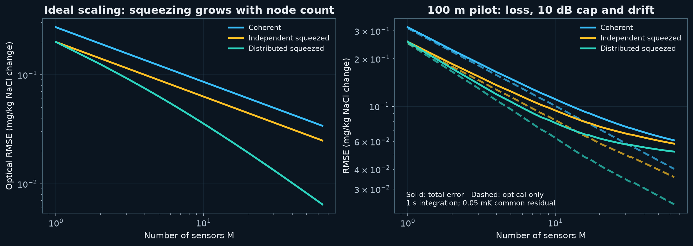
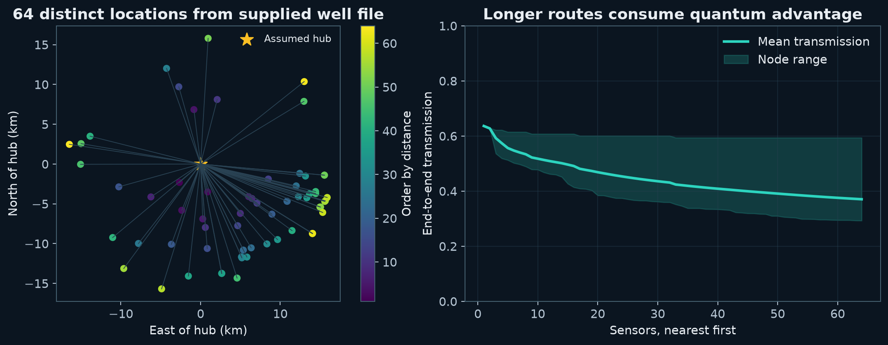
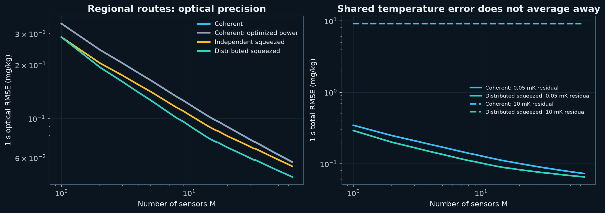
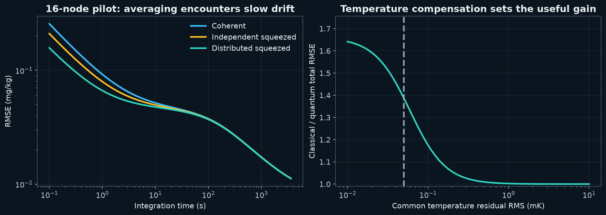
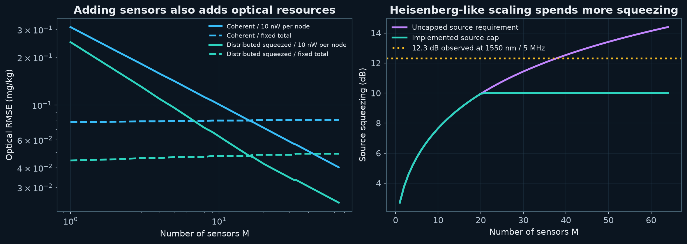
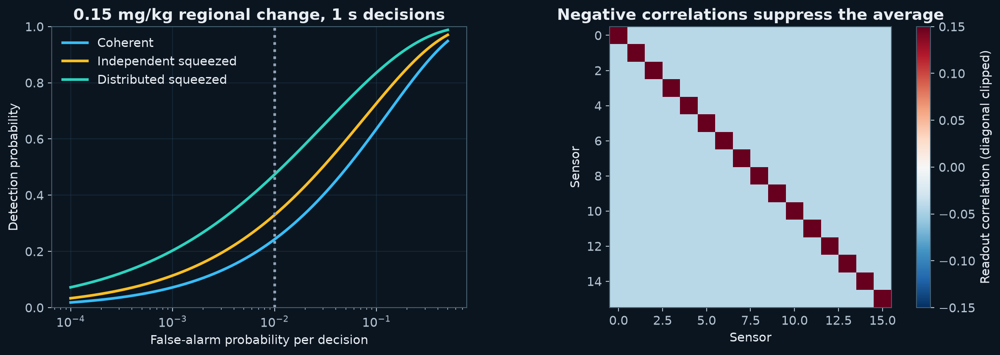
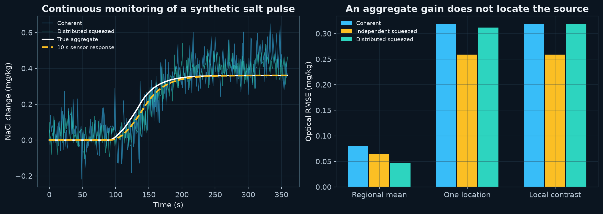
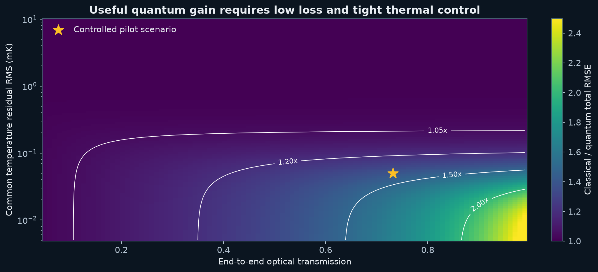
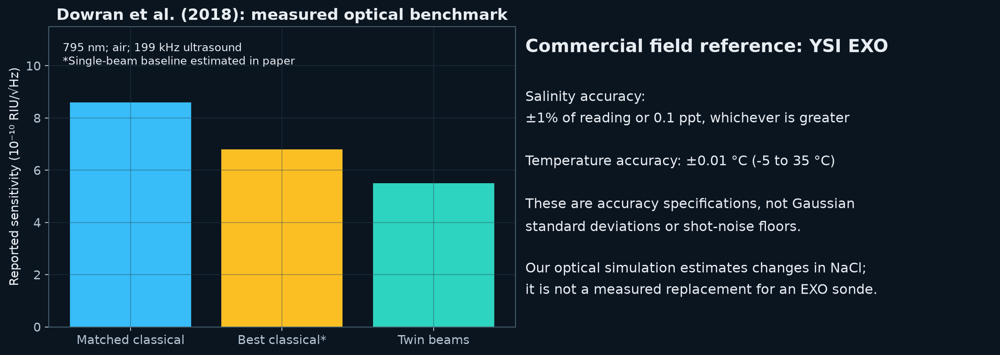
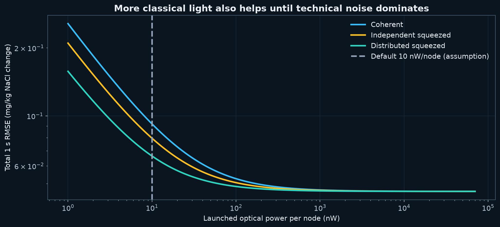

# Team 7 — Continuous quantum sensing for water-quality changes

**Technical report • 7 October 2026 • Reproducible simulation, not a field trial**

## Executive summary

**Problem and importance.** Water-quality monitoring has major gaps: the UN's 2025 SDG report records about two million measurements used in global reporting, of which only 60,000 came from the poorest regions. WHO reports that at least 1.7 billion people used faecally contaminated drinking-water sources in 2022. These dated findings establish the importance of monitoring and safe-water management; they do not imply that a salt sensor detects microbial hazards. [UN SDG 6 report, S14](https://unstats.un.org/sdgs/report/2025/Goal-06/); [WHO, S13](https://www.who.int/news-room/fact-sheets/detail/drinking-water).

**Our specific question.** Can shared squeezed light improve the precision of an optical signal averaged across several water-sampling taps when launched probe photons are constrained? We propose a laboratory study of **differential NaCl-equivalent concentration**, a calibrated refractive-index proxy. An eventual operator could use a validated change to request inspection and confirmatory sampling. This role follows established online monitoring practice; the need for our particular sensitivity and photon constraint remains an unvalidated application assumption. [EPA monitoring guidance, S15](https://www.epa.gov/waterresilience/online-water-quality-monitoring-resources).

**Solution and contribution.** A 1550 nm squeezed-light source is split among sampling taps; water-induced phase changes are measured locally and combined into a mean. Distributed squeezed-light estimation and a four-node optical demonstration already exist, as does a published NaCl optical calibration. Our contribution is their integration into a reproducible water-proxy feasibility model with photon-matched baselines, spatial loss, thermal drift, response lag and decision thresholds. We claim this application and analysis as project work, not a new quantum principle or an established first-of-its-kind invention. [Zhuang et al., S4](https://arxiv.org/abs/1711.10459); [Guo et al., S6](https://arxiv.org/abs/1905.09408); [Saunders et al., S7](https://doi.org/10.1364/AO.55.000947).

**Current result.** In the assumed 16-tap scenario, total root-mean-square error (RMSE) falls from **0.09210 to 0.06639 mg/kg**, a **27.92% reduction** versus coherent light, and 16.58% versus independent squeezers. The comparison uses 100 m links, 10 nW per tap, 1 s windows and a demanding 50 µK common temperature residual. For a settled 0.15 mg/kg mean increase, modeled detection rises from **24.27% to 47.33%** at the same 1% false-alarm probability per decision. These are simulation outputs, not water measurements; 16 taps is an illustrative design choice, not a literature-established optimum. [Result data](../results/summary.json); [design rationale](DESIGN_DECISIONS.md).

**What this means.** The model establishes a conditional precision advantage, not reliable event detection or a field-ready sensor. At an assumed 10 mK temperature residual both strategies have about 9.137 mg/kg error; at 64 geographically dispersed sites the gain is only 1.11× against optimized coherent power. A derived same-model comparison shows that increasing coherent power from 10 to approximately **28 nW per tap** matches the 10 nW squeezed result. The next decision is therefore whether a real transducer can meet the noise budget and whether restricting probe power has practical value. No water-safety, cost, electrical-energy or sustainability benefit has yet been measured. [Results and comparisons](RESULTS.md).

## 1. The problem and the solution idea

### A concrete measurement problem

The public problem is insufficient information about changing water quality. UN reporting documents unequal monitoring coverage, and EPA guidance describes online measurements as a way to support treatment optimization and contamination-event detection. This motivates timely measurements, but does not establish that quantum readout noise is the main obstacle: infrastructure, chemistry, calibration, maintenance and response capacity also need to be addressed. [S14](https://unstats.un.org/sdgs/report/2025/Goal-06/); [S15](https://www.epa.gov/waterresilience/online-water-quality-monitoring-resources).

**Proposed use case (assumption):** an operator in a treatment or reuse facility wants to investigate small, sustained composition changes across several sampling taps. Our precise task is to estimate the arithmetic mean of concentration changes across the installed taps, allowing different local changes. We have no partner-derived detection threshold, deployment count or water-savings estimate. Site placement and a local alarm policy must be designed separately; an average can hide an isolated event.

**Why this proxy:** Saunders et al. measured refractive indices of NaCl solutions at 1550 nm, giving us a traceable concentration-to-index relation. A refractive-index change is not unique to salt or to a harmful contaminant: their measurements cover several solutes, and water temperature also changes the index. We therefore report **mg/kg differential NaCl-equivalent concentration**, not nitrate, arsenic, microbial contamination or generic “water purity.” A small change in this proxy is not a health threshold. [S7](https://doi.org/10.1364/AO.55.000947); [thermal measurement, S10](https://opg.optica.org/abstract.cfm?uri=sensors-2012-STu1F.3).

**Intended impact pathway (untested):** measure a validated change → inspect and take a chemically specific sample → make an operator decision → measure any avoided loss or exposure. WHO's water-safety framework places monitoring within risk management and independent surveillance. Our simulation covers only the first measurement step; it does not quantify the later outcomes. [S13](https://www.who.int/news-room/fact-sheets/detail/drinking-water).

### Proposed physical system

A 1550 nm source supplies a bright carrier plus a squeezed optical mode. A distribution network splits the squeezed mode among water-sampling taps. Each tap converts an index change into a small optical phase shift; local homodyne detection measures the appropriate quadrature. Classical software calibrates the readouts and estimates their mean. The proposed readout adapts published distributed CV sensing; the water transducer, network size and component efficiencies are project assumptions. Correlations reduce noise in the modeled aggregate at a matched launched-probe photon budget. [S4](https://arxiv.org/abs/1711.10459); [S6](https://arxiv.org/abs/1905.09408).

The product at this stage is an open, reproducible simulation and laboratory design study. A possible later product is a monitored optical sampling module with operator software and conventional confirmatory analysis. It is not currently a mobile app, a quantum computer, a commercial sensor, or a verified installation.

### Why quantum resources might help

Independent shot noise averages as the inverse square root of the number of comparable measurements. A shared squeezed mode can introduce negative correlations between readout noise terms. Those terms partially cancel in the mean. In an ideal lossless limit, with total squeezed energy increasing with sensor count, the aggregate RMS error approaches inverse sensor-count scaling. This is the literature mechanism we model, not a faster classical calculation. Loss and resource limits qualify that scaling. [S4](https://arxiv.org/abs/1711.10459).

Remove squeezing and the controlled 16-tap result changes from 0.06639 to 0.09210 mg/kg total RMSE. That is our concrete “no quantum” test. Remove the low-dose constraint or introduce sufficiently large technical drift, however, and the practical reason to pay for quantum hardware becomes much weaker.

## 2. Evidence hierarchy and what each paper contributes

Three kinds of information must remain separate throughout this report:

1. **Measured or published anchors:** NaCl index calibration, reported squeezing demonstrations, bare-fiber attenuation, thermo-optic sensitivity, and commercial specification bounds.
2. **Proposed engineering choices:** effective optical interaction length, node power, detector efficiency, sample loss, source bandwidth, thermal compensation, calibration stability, topology, and alarm settings.
3. **Computed results:** error curves and synthetic detection probabilities obtained by applying the model to those anchors and choices.

The supplied Dowran paper demonstrates optical enhancement in air under radio-frequency modulation, not slow water chemistry. The supplied Pooser–Lawrie attachment explains loss in a twin-beam experiment; it is supporting information from a different study. The supplied water-QML paper informs our insistence on strong classical baselines and data provenance, but supplies neither the optical transducer nor a sensor noise rate. Distributed CV theory and the four-node Guo experiment supply the mechanism and laboratory precedent. The complete bibliographic and numerical register appears in Appendix A.

### Literature, team discussion and our additions

Team chats and the earlier proposal are records of ideas, not independent evidence. A paper mentioned in a discussion supports only the experiment or model it actually reports. We use published sources for physical anchors, label unmeasured choices as assumptions, and link our own numerical claims to saved outputs. The paper descriptions below identify the boundary between those roles.

| Input | What it supports | What we add / must still establish |
|---|---|---|
| [Dowran optical experiment, S1](https://doi.org/10.1364/OPTICA.5.000628) and loss supplement S2 | Squeezed-light sensing and the penalty from optical loss | A different water-proxy transducer; the reported air sensitivity cannot be copied into water |
| [Distributed theory, S4](https://arxiv.org/abs/1711.10459), [S5](https://doi.org/10.1103/PhysRevResearch.2.023030) and [four-node experiment, S6](https://arxiv.org/abs/1905.09408) | Estimating an aggregate with correlated optical probes | Lossy tap geometry, technical error budgets and fair comparator analysis; 16/64 nodes remain extrapolations |
| [NaCl measurements, S7](https://doi.org/10.1364/AO.55.000947) | An empirical index slope at 1550 nm | Conversion to phase using an assumed effective length; a real cell must be calibrated |
| [Water-QML study, S3](https://www.mdpi.com/2624-960X/8/3/60) | A separate data-analysis study that compares quantum and classical kernels | No QML in this project; it does not justify our sensor count or optical noise |
| Team discussion and supplied groundwater file | Motivation, candidate scenarios and coordinates | No independent proof of performance, fiber availability or site-specific water quality |

The project contribution is the combined, reproducible feasibility analysis and its explicit failure conditions. An exhaustive novelty search has not been performed; “novel additions” here means additions made within this project, not verified research priority.

## 3. Observable, equations, and fair comparison

Let cᵢ denote the local NaCl concentration change at tap i, and M the number of installed taps. The target is q = Σcᵢ/M. Changing M changes the set of sampled taps in the regional experiment, so the curves are not estimates of one fixed 64-site population using incomplete samples.

The empirical index polynomial from Saunders et al., Table 2, uses mass fraction W = c/10⁶. [S7](https://doi.org/10.1364/AO.55.000947):

> n(W) = −0.0800 W³ + 0.0740 W² + 0.1620 W + 1.3162.

At the assumed background of 500 mg/kg, dn/dc = 1.6207394 × 10⁻⁷ RIU/(mg/kg). With the proposed effective interaction length of 10 µm and wavelength 1550 nm, the phase sensitivity is k = (2πL/λ)(dn/dc) = 6.5699393 × 10⁻⁶ rad/(mg/kg). This derivative anchors differential sensitivity; it does not certify absolute sub-mg/kg concentration accuracy.

Our implementation adapts the split-state construction in [S4](https://arxiv.org/abs/1711.10459), using vacuum quadrature variance one. Splitting a squeezed mode gives Vₓ = I + (v−1)uuᵀ, where u is the all-ones vector divided by √M and v = (√(Nₛ+1)+√Nₛ)⁻². Loss attenuates the state and injects vacuum. After calibrating each homodyne readout, the distributed concentration covariance is

> Σ = [diag(1/ηᵢ) + (v_eff−1)uuᵀ] / (4F_cTk²).

The mean estimator uses weights wᵢ=1/M and variance wᵀΣw. Phase jitter mixes squeezed and antisqueezed quadratures into v_eff. Independent squeezers receive the same total squeezed photon budget, divided among nodes. Coherent probes use the same total launched photons. For unequal regional losses we also permit a stronger coherent baseline, redistributing total optical power with Fᵢ proportional to 1/√ηᵢ. It retains the same target mean rather than quietly dropping distant sites.

At 10 nW/node the photon flux is 7.8029 × 10¹⁰ s⁻¹/node. The squeezed flux B Nₛ is subtracted from the carrier allocation: F_c = F − B Nₛ/M. Pump electricity, local oscillators, refrigeration if any, stabilization, readout electronics, and classical computation are outside this optical ledger. Equal probe dose is not equal total energy or equal financial cost.

As a modeling assumption, total MSE adds independent optical, session-calibration and common-temperature contributions. The calibration variance is divided by M because its offsets are assumed independent across taps. The temperature-to-index coefficient is anchored to [S10](https://opg.optica.org/abstract.cfm?uri=sensors-2012-STu1F.3). Temperature follows an assumed stationary Ornstein–Uhlenbeck process with a 60 s correlation time. Its averaging factor is 2[x+exp(−x)−1]/x² for x=T/60 s. This retains slow drift rather than treating every second as an independent temperature measurement. Fixed calibration offsets do not vanish through temporal averaging.

The fuller derivation, conventions, jitter approximation, and limitations are in [MODEL.md](MODEL.md). The simulation computes an achievable estimator covariance. It does not insert a desired 1/M error law, calculate a fictitious quantum Fisher information, or establish universal optimality of homodyne detection.

## 4. Technical simulation: implementation, inputs and outputs

This section addresses the template’s hack-stack and algorithm requirement. The simulation runs classically; the proposed quantum optics have not been built. Reproduction commands and validation scope are in [SIMULATION.md](SIMULATION.md).

### Languages and libraries

| Component | Implementation | Role |
|---|---|---|
| Scientific model and experiments | Python 3.12; [requirements.txt](../requirements.txt) pins NumPy 2.3.5, SciPy 1.18.1, pandas 2.2.3, Matplotlib 3.11.2 | CPU numerical calculations and deterministic regeneration |
| NumPy | Arrays, linear algebra, polynomial operations, seeded random generator | Covariance propagation, estimator variance and synthetic Gaussian noise |
| SciPy | SI constants, normal distribution; root solving in the comparison helper | Photon conversion, analytic detection probabilities and classical-power matching |
| pandas | CSV input/output and tabular filtering | Geometry, scenario tables and plotted series |
| Matplotlib with Agg backend | Static plots | Ten PNG/SVG figures; no graphical desktop needed |
| Python standard library | argparse, json, pathlib, hashlib, unittest | Configuration, paths, hashes and 13 model checks |
| Presentation authoring | JavaScript ES modules in Node.js with bundled `@oai/artifact-tool` | Editable PPTX export and validation; separate from the science |
| Offline presentation | Python-generated HTML/CSS/JavaScript | Browser slideshow with embedded charts and notes |
| PDF export | Node.js, Playwright and Chrome | Prints the HTML slide deck; does not run quantum calculations |

There is no Qiskit/PennyLane dependency, quantum circuit, GPU requirement, trained neural network or optimization over a learned model. No API key or cloud account is required for scientific reproduction. Presentation export uses the separately supplied artifact runtime; see [BUILD_PRESENTATION.md](BUILD_PRESENTATION.md).

### Development approach

The implementation encodes the published split-squeezed-state mechanism from [Zhuang et al.](https://arxiv.org/abs/1711.10459), with a local homodyne estimator and a chemical slope from [Saunders et al.](https://doi.org/10.1364/AO.55.000947). Project code adds engineering assumptions for the transducer, losses, drift and lag, then compares baselines under explicit optical budgets. It computes covariance and error from the equations; it does not hardcode an error proportional to 1/M. The ideal exponent is fitted to generated values.

The existing [model.py](../src/model.py) is the numerical kernel; [run.py](../src/run.py) defines experiment sweeps and figures; [validate.py](../src/validate.py) checks model identities and statistical consistency. [prepare_geometry.py](../src/prepare_geometry.py) selects distinct coordinates from the historical input. This revision adds [practical_comparisons.py](../src/practical_comparisons.py) to reproduce the classical-power, localized-event and detection-target interpretations. The scientific equations and default parameters were not changed by the documentation revision.

Team discussions supplied candidate ideas. They did not calibrate component efficiencies or prove a sensor count. All parameter choices are classified in [DESIGN_DECISIONS.md](DESIGN_DECISIONS.md). This account describes the code and reproducible calculation, not an independently audited development history.

### Inputs and their meaning

| Input | Contents | How it is used |
|---|---|---|
| [config/default.json](../config/default.json) | Wavelength, chemical fit, optical budget, efficiencies, thermal/calibration assumptions, seed and decision settings | Numerical specification of the default scenario |
| [data/site_geometry.csv](../data/site_geometry.csv) | 64 distinct supplied locations with distances to an assumed hub | Regional loss scenarios; not measured fiber routes or contamination concentrations |
| [data/draft_sha256.json](../data/draft_sha256.json) | Original draft file hashes | Preservation check, not validation of the original scientific claims |
| Synthetic events in `run.py` | Staggered local concentration rises, assumed response lag and noise | Illustrative continuous monitoring trace |
| Published constants | NaCl fit, water thermo-optic coefficient, fiber attenuation | Traceable anchors embedded in configuration; experiment code does not fetch papers at runtime |

The headline concentration unit is **mg/kg differential NaCl-equivalent**. The supplied arsenic-labelled measurements are not converted to NaCl or used to train a model. Coordinates provide a geometry stress test only. No live instrument feed enters this simulation.

### Calculation sequence

1. **Load the scenario.** Read configuration and geometry. Seed NumPy with 2601006. Select node counts M=1…64 and pilot or regional links.
2. **Convert chemistry into phase.** Differentiate the measured NaCl index polynomial at the assumed 500 mg/kg background. Multiply by 2πL/λ using the assumed 10 µm effective interaction length.
3. **Account for resources and transmission.** Convert launched power into photon flux. Deduct squeezed photons from carrier allocation. Calculate fiber and component losses; cap the source at 10 dB.
4. **Construct the readout covariance.** Propagate the squeezed state through loss, include phase-jitter mixing and calibrate each local output into concentration units. Coherent, independent squeezed and distributed states share the declared probe budget. A regional comparator optimizes coherent power allocation.
5. **Estimate the mean and its error.** Use q̂=Σyᵢ/M and optical variance wᵀΣw. Add independent calibration variance/M and common temperature variance, including the exact averaging factor of the assumed 60 s OU process. Take the square root for total RMSE.
6. **Run decisions and a time trace.** The settled Gaussian test uses a 0.15 mg/kg mean step and 1% false alarm per decision. Generate 100,000 null and 100,000 alternative draws per strategy to check the analytic probabilities. Separately generate a 360 s synthetic trace with unequal arrivals, shared drift and 10 s first-order response lag.
7. **Sweep and export.** Explore sensor count, resources, power, integration, loss and temperature. Save numeric series before plotting. Generate report tables and decks from saved results.

The main RMSE curves are analytic covariance calculations; the Monte Carlo draws check decision probabilities. The time trace is a third, distinct output. Its single seed cannot establish operational detection delay or false-alarm performance. Calibration offsets persist in time, while common drift does not disappear by adding taps.

### Outputs and what they establish

| Output | Contents and interpretation |
|---|---|
| [results/summary.json](../results/summary.json) | Exact headline errors, detection probabilities, ideal fitted exponents and configuration hash |
| `scaling.csv`, `resources.csv`, `averaging.csv`, `power_sensitivity.csv` | Scenario curves; each row describes modeled settings and outputs |
| [results/detection.csv](../results/detection.csv) | Analytic and Monte Carlo detection/null probabilities |
| [results/time_trace.csv](../results/time_trace.csv) | Synthetic truth, sensor response and noisy estimates; no field measurements |
| `results/feasibility.npz` | Numerical grid of loss/temperature sensitivity |
| [results/practical_comparisons.json](../results/practical_comparisons.json) | Derived power matching, 95% detection requirements and single-tap dilution |
| [results/validation.txt](../results/validation.txt) | Saved model-check log; validates implementation, not unmeasured physical assumptions |
| [figures/index.html](../figures/index.html) | Offline gallery of ten PNG/SVG figures |
| [docs/RESULTS.md](RESULTS.md) | Generated numerical results and interpretations |
| [presentation/Presentation.html](../presentation/Presentation.html) and PPTX/PDF files | Communication artifacts; presentation tools do not supply scientific results |

**Worked example:** default 16 taps, 100 m links, 10 nW/tap, 1 s and 50 µK common temperature residual produce η=0.731827. The resulting total RMSE is 0.092101 mg/kg coherent and 0.066389 mg/kg distributed. The model predicts a reduction of 27.92%. Those inputs are engineering assumptions except where the source register identifies measured anchors; the output is a prediction, not a measurement.

## 5. Assumptions and parameter provenance

Appendix A identifies the sources and parameter categories; [DESIGN_DECISIONS.md](DESIGN_DECISIONS.md) gives the reason, evidence status and validation requirement for every configuration setting. [default.json](../config/default.json) is the executable numerical specification. The most consequential assumptions are:

- **Low optical dose:** 10 nW/node is a test budget; no supplied evidence shows that water requires this limit. A power sweep tests whether a stronger classical probe would be a simpler solution.
- **Optical transducer:** the 10 µm effective length and 90% sample transmission are a proposed combination, not a characterized device. Changing interaction length changes the optical concentration error scale.
- **Thermal compensation:** 50 µK common residual is an ambitious controlled target, far below the cited commercial absolute temperature accuracy. The separate 10 mK case is a stress test, not a Gaussian conversion of a manufacturer's accuracy specification.
- **Source/readout:** a 10 dB squeezing cap and a flat 1 MHz effective mode rate are not jointly demonstrated for this proposed DC-water instrument. Modulation and demodulation into the squeezing band must work in hardware.
- **Scalable distribution:** detector, coupling, splitter, and phase-lock performance are targets. Increasing nodes does not guarantee that these remain unchanged.
- **Noise distributions:** Gaussian optical/readout errors and zero-mean calibration ensembles are idealizations. A fixed common bias, fouling, rare failures, and non-Gaussian tails can be more important than the modeled RMSE.

Additional constants are simulation design settings, not literature measurements: seed 2601006; 1 s headline integration; M=1…64; the ideal slope fit uses M=33…64; the power sweep spans 1 nW–70 µW; the feasibility map spans transmission 0.05–0.99 and temperature RMS 0.005–10 mK. The continuous example spans seconds 0–359, staggered event arrivals at 90–135 s, mean amplitude 0.35 mg/kg with ±25% sinusoidal spatial variation, 25 s rise, and 10 s sensor response. ROC simulations use 100,000 null and 100,000 alternative draws per strategy. These choices make hypotheses inspectable; they are not inferred event statistics.

### Realistic sensor counts and geography

**Why 16 sensors?** This is an illustrative engineering assumption: it exercises four binary splitter stages and multi-tap averaging while remaining below the model's source cap (Nₛ=1.6 versus a 2.025 photons/mode cap). Those are transparent analytical conveniences, not evidence that 16 is optimal or operationally necessary. The cited [Guo experiment, S6](https://arxiv.org/abs/1905.09408) used four nodes. Begin hardware work at one/four taps; choose a larger count only after measuring loss and defining coverage with an operator. The assumed 100 m links represent a compact facility scenario; no facility layout was surveyed. The sweep to 64 tests scaling and loss, not 64 deployed quantum water probes.

For the regional stress test, the supplied groundwater file contains 8,889 records and 7,704 distinct coordinate pairs. We select the nearest 64 **distinct locations** to an assumed hub at (34.05, −118.24). Great-circle distances range from 3.5245 to 16.6434 km; route lengths are multiplied by an assumed 1.3 routing factor. The mean route is 16.3847 km at M=64. Coordinates are not proof of available fiber, site access, water transport, or synchronized measurements.

Transmission is ηᵢ = 0.95 × 0.90 × 0.90 × 10^[−(0.18Lᵢ + 0.05 ceil(log₂M))/10]. The 0.18 dB/km fiber coefficient is literature/manufacturer anchored; the remaining component and routing terms are assumptions. [Corning AN2008, S9](https://www.corning.com/media/worldwide/coc/documents/Fiber/application-notes/AN2008.pdf). The source file is USGS-labelled but lacks sufficient query and sampling metadata for independent environmental validation. Only coordinates and identifiers are transferred. Arsenic measurements are never relabelled as salt data.

## 6. Experiments and results

All experiments below are numerical unless explicitly labeled “published measurement” or “manufacturer specification.” RMSE describes repeated, modeled estimation errors around a reference; it is not an absolute instrument accuracy specification. Values come from [summary.json](../results/summary.json), the corresponding [CSV outputs](../results/) and the [derived practical comparisons](../results/practical_comparisons.json).

### What did we demonstrate?

| Test | Takeaway | Conditions and boundary of the claim |
|---|---|---|
| Controlled 16-tap comparison | Shared squeezing reduces total error 27.92% versus coherent and 16.58% versus independent squeezers | Assumed short links, equal launched photons, 1 s, 50 µK common residual; verifies the model prediction, not hardware |
| Ideal scaling | Fitted distributed RMS exponent −0.953 versus −0.500 coherent | Lossless, no jitter, increasing total squeezing, no source cap; no deployable 1/M guarantee |
| Regional loss | Gain falls to 1.11× against optimized coherent power | 64 supplied coordinates, assumed routes/components, capped source; not a surveyed network |
| Thermal stress | Quantum benefit becomes negligible at 10 mK residual | Same modeled drift affects both strategies; controlling technical noise is the first practical priority |
| Detection | 24.27% → 47.33% probability of detecting the specified step | 0.15 mg/kg mean step, settled signal, 1% false alarm per window; more than half of events are still missed |
| Classical power alternative | Approximately 28 nW/tap coherent matches 10 nW/tap distributed performance | Same transducer and technical noise; relaxes equal dose and therefore tests the reason for the quantum constraint |
| Continuous trace | Demonstrates estimation with lag and unequal arrivals | One synthetic realization; no measured detection-delay or field reliability result |

**Answer for a judge:** we verify an internally consistent, conditional model prediction and identify ways it fails. We have not experimentally proved a quantum water-sensor advantage, discovered a new scaling law, or demonstrated a useful operational alarm. The negative thermal and power results are central findings.

### Experiment 1 — Ideal scaling versus a controlled pilot

**Question:** Does the CV mechanism produce a genuine change in node-count scaling, and does that survive practical constraints?

The ideal reference removes loss, jitter, technical drift, and the source cap, while total squeezed photons grow as Nₛ=0.1M. Fits over M=33–64 give RMS slopes −0.500 for coherent light, −0.500 for independent squeezers, and −0.953 for the distributed state. The latter approaches the ideal −1 behavior. Growing total squeezing is an explicit resource increase.

The practical panel reinstates loss, source cap, jitter, calibration, and temperature. Its useful finite-size improvement is not an asymptotic Heisenberg claim. At M=16, transmission is 0.731827 and source squeezing is 9.1799 dB (Nₛ=1.6). The total errors are 0.092101, 0.079585, and 0.066389 mg/kg for coherent, independent squeezed, and distributed squeezed probes respectively. Distributed squeezing reduces total RMSE by 16.58% relative to independent squeezing, so the claimed benefit is not merely “any squeezing beats no squeezing.”

### Experiment 2 — Geography-dependent loss

**Question:** What changes when more sensors require longer optical paths?

The selected real-coordinate geometry supplies distances; the physical network is hypothetical. At 64 sites, mean transmission is 0.370664, with range 0.292923–0.593929. Fiber attenuation and the growing splitter-depth approximation penalize larger networks. This grounds the sensor-count study in a spatial cost instead of giving every added node a free lossless connection.

More sites improve coverage of the selected locations, but the simulator does not quantify population coverage, flow-weighted water quality, missed hotspots, or the value of placing a sensor elsewhere. Those are separate sampling-design problems.

### Experiment 3 — Strong classical baseline and the thermal failure regime

**Question:** Does advantage persist against a better classical allocation and more realistic common drift?

At 64 regional nodes, total RMSE is 0.073059 mg/kg for equal-power coherent probes, 0.072887 for optimized coherent power, 0.070654 for independent squeezing, and 0.065536 for distributed squeezing. The quantum precision ratio against the stronger coherent baseline is only 1.112×. Unequal-loss optimization makes the comparison fairer even though its numerical change is small in this geometry.

At 10 mK common residual, both pilot strategies have approximately 9.137 mg/kg RMSE. Adding correlated technical noise is enough to make the optical improvement operationally negligible. This is an important negative result, not a plotting inconvenience.

### Experiment 4 — Integration time and thermal compensation

**Question:** Can longer averaging rescue the measurement?

Optical white-noise variance falls as 1/T, but common temperature drift does not initially average that way. The exact OU averaging factor approaches one for windows much shorter than 60 s and approaches 2τ/T for sufficiently long windows. Independent calibration offsets remain a temporal floor. Longer integration can lower random noise but also delays detection and blurs changing water conditions.

Using the measured thermo-optic coefficient [S10](https://opg.optica.org/abstract.cfm?uri=sensors-2012-STu1F.3) and NaCl slope [S7](https://doi.org/10.1364/AO.55.000947), our calculation gives: 1 mK corresponds to approximately 0.916 mg/kg apparent concentration change. Even a tiny residual matters more than shot noise unless compensation is exceptionally good. This is the main experimental requirement exposed by the model.

### Experiment 5 — Resource accounting

**Question:** Is a better exponent being purchased with increasing resources?

We compare fixed per-node power with fixed total launched power (160 nW) and fixed total squeezed photons (Nₛ=1.6). The near-1/M reference requires squeezing energy to grow with M. Under the practical 10 dB cap, total source Nₛ stops at 2.025 photons/mode; the cap becomes active above 20 nodes in the Nₛ=0.1M schedule. With finite loss, the unsqueezed vacuum contribution ultimately restores square-root optical scaling even without a cap.

This comparison prevents a false conclusion that sensor count itself creates unlimited precision. A fair engineering comparison must state whether it fixes dose per tap, total dose, source energy, integration time, footprint, or total financial and electrical cost.

### Experiment 6 — Detection probability and readout correlations

**Question:** Does lower RMSE improve a concrete decision at matched false-alarm probability?

We test a one-sided, settled 0.15 mg/kg mean increase in 1 s windows at 16 taps, with 1% false-alarm probability per decision. The analytic detection probabilities are 24.27% coherent, 32.94% independent squeezed, and 47.33% distributed squeezed. The thresholds are respectively 0.214259, 0.185142, and 0.154445 mg/kg. A lower threshold at the same false-alarm probability follows from lower uncertainty, not from relaxing the decision criterion.

Monte Carlo estimates are 24.311%, 33.160%, and 47.512%; null false-alarm estimates are 0.997%, 0.962%, and 1.033%. The validation checks agreement within sampling uncertainty. These draws test the Gaussian marginal calculation, not unmodeled physical sensor noise. The correlation panel displays the negative readout correlations that enable aggregate cancellation.

At 1 Hz, a 1% marginal rate implies 36 expected flagged windows per hour under the null. Correlations change clustering, not this expectation. This is not an acceptable deployed alarm policy by itself. Sequential testing, hysteresis, confirmation, and a time-based false-alarm budget need a separate study. A 47.33% probability is also not reliable detection of every such event.

### Experiment 7 — Continuous monitoring of a synthetic event

**Question:** How does the estimator behave when local signals arrive at different times?

Sixteen taps receive synthetic rises with staggered arrival times and unequal amplitudes. The sensor response has a 10 s time constant. Both strategies see the same thermal drift and calibration realization; their optical draws differ. The plot distinguishes instantaneous truth, the filtered signal the sensor can actually follow, and noisy observations.

Quantum noise reduction makes the aggregate cleaner under the assumed conditions, but cannot eliminate response lag or infer which chemical caused the change. Nor does a low-noise mean locate a hotspot: an isolated large change may be diluted by many unaffected taps. The stationary RMSE should not be reported as total tracking error during a fast transient, when lag bias is also present. A single seeded trace is an illustration rather than a statistical forecast of field incidents.

### Experiment 8 — Feasibility map

**Question:** Which combinations of transmission and thermal control leave meaningful advantage?

We sweep optical transmission and common residual temperature at fixed pilot resources. High transmission and low technical noise preserve the strongest gain. Loss replaces useful squeezing with vacuum; increasing common drift masks the remaining optical benefit. The resulting surface is a design map for prioritizing measurements, not a probability that the project will succeed.

### Experiment 9 — Published experiments and real sensor specifications

**Question:** Which numerical comparisons are externally measured, and which are ours?

Dowran reports 8.6×10⁻¹⁰ RIU/√Hz for a matched classical comparator, 6.8×10⁻¹⁰ for its inferred optimal single-beam comparator, and 5.5×10⁻¹⁰ for twin beams. The corresponding gains are 1.56× and 1.24×. These are optical sensitivity measures at 795 nm and 199 kHz in air, not a 1 s water accuracy claim. [Dowran et al., S1](https://doi.org/10.1364/OPTICA.5.000628).

The YSI EXO salinity specification is ±1% or 0.1 ppt, whichever is greater; temperature accuracy is ±0.01 °C in the stated range. NitraLED's separate pure-water nitrate specification is ±0.1 mg/L-N or 5% for the cited range, with T95<30 s. Manufacturer accuracy bounds, differential Gaussian RMSE, spectral sensitivity, practical salinity, and nitrate-N are different quantities. A performance ratio between these unlike metrics would be misleading. [YSI EXO, S11](https://www.ysi.com/product/id-599870/exo-conductivity--temperature-smart-sensor); [NitraLED, S12](https://www.ysi.com/exo/nitraled).

### Experiment 10 — More classical optical power

**Question:** Would increasing classical power be an easier way to improve measurement?

The 1 nW–70 µW sweep relaxes the deliberately restrictive optical dose. More coherent photons reduce shot noise until technical errors dominate. The quantum-to-classical total precision ratio approaches one in that regime. This challenges the business case directly: the project needs a defensible reason to constrain probe dose, or a measured advantage at matched total cost or energy, before quantum hardware is preferable.

The top end of this sweep is a parameter exploration. It is not a claim that the proposed water geometry is validated at that power or that the detected power of the Dowran apparatus can be transferred unchanged to this device.

### Practical comparisons: what would the numbers mean?

- **A stronger classical probe is a serious alternative.** Solving the same noise model gives 27.998 nW/tap coherent power to match the 10 nW/tap distributed RMSE. This is about 2.8 times the probe power, with all other assumptions fixed. It is a conditional engineering comparison, not a hardware cost estimate. At 70 µW/tap both modeled total errors approach 0.0463 mg/kg, the technical floor.
- **Improved detection is not dependable detection.** To obtain 95% detection at the same 1% per-window false-alarm rate, the Gaussian model needs a mean step of approximately 0.366 mg/kg coherent or 0.264 mg/kg distributed. These are calculated operating points, not regulatory limits. A 1% false-alarm rate still means 36 expected flagged windows/hour at 1 Hz.
- **An aggregate can miss a local problem.** If only one of 16 taps changes by 0.15 mg/kg, the mean changes by 0.009375 mg/kg. The modeled detection probabilities fall to 1.31% and 1.44%, close to the 1% null flag rate. The headline detection result therefore concerns a network-mean increase, not detection of any affected tap.
- **A 1 s readout is not a 1 s sensor response.** Our assumed first-order 10 s response constant implies about 30 s to reach 95% of a step. YSI specifies T95<30 s for its nitrate sensor, but that measures a different chemical observable. This comparison locates the assumed response on an existing instrument timescale; it does not demonstrate equivalent performance. [S12](https://www.ysi.com/exo/nitraled).
- **Temperature is an unusually demanding condition.** The 50 µK residual target is 200 times smaller numerically than the EXO ±0.01 °C absolute accuracy bound. Residual drift and absolute accuracy are different quantities, so this is a scale comparison only; an independent reference or differential compensation scheme would need experimental verification. [S11](https://www.ysi.com/product/id-599870/exo-conductivity--temperature-smart-sensor).

These derived comparisons are reproduced by [src/practical_comparisons.py](../src/practical_comparisons.py); parameters and outputs are preserved in [practical_comparisons.json](../results/practical_comparisons.json).

## 7. What this establishes about the literature

**It neither proves nor disproves the experimental literature.** We use published relations and measured anchors as inputs, then check whether the implemented model behaves consistently with them. Agreement is evidence of a correctly implemented conditional mechanism, not an independent experimental replication.

| Literature claim or interpretation | What our work can conclude |
|---|---|
| Distributed CV squeezing can improve estimation of an aggregate | Consistent: covariance propagation and the estimator show finite-resource improvement |
| Ideal inverse-node RMS scaling can occur | Consistent under lossless operation and growing total squeezing; the fitted finite-range exponent is −0.953 |
| The same exponent persists with realistic loss and capped resources | Not supported; our model returns to ordinary optical scaling and may reach a technical floor |
| Twin-beam optical sensing beats an appropriate classical comparator | The supplied measured numbers support that specific optical experiment; our water simulation does not replicate it |
| Homodyne always attains the quantum optimum | Not established and not assumed; loss and readout choices matter |
| Quantum ML gives superior water pollution prediction | Not tested here; the supplied paper's matched classical RBF comparator remains important |
| A quantum network detects arbitrary water contaminants more accurately in the field | Not established: chemical selectivity, realistic drift, hardware and operational validation are missing |

The work rejects an **unconditional interpretation** of quantum scaling, not the qualified theory that predicts its limitations. The strongest outcome is a falsifiable design hypothesis: under a measured low-dose budget, efficient short links, and sufficient technical-noise suppression, shared squeezing should reduce the error of a specified water-proxy mean beyond matched coherent and independent-squeezing baselines.

## 8. Reliability, uncertainty, and reproducibility

The 13 model checks cover Gaussian physicality, full-state/readout covariance agreement, an equal-loss closed form, vacuum/high-loss limits, one-node agreement, arbitrary local signals, coherent power optimization, concentration units, OU limits, Monte Carlo consistency, unique coordinates, and preservation of the original draft. These validate internal implementation properties. Passing them does not validate assumed component values.

There are four distinct uncertainty layers: random readout uncertainty represented by RMSE; Monte Carlo sampling uncertainty in estimated probabilities; uncertain physical parameters such as effective length and residual drift; and structural uncertainty from omitted physics. Only the first two receive numerical statistical treatment here. Parameter sweeps reveal sensitivity but are not confidence intervals on real hardware performance.

Run the project from its root with `bash src/reproduce.sh`; consult [README.md](../README.md) for dependencies and commands. The seed is 2601006. [summary.json](../results/summary.json) records the configuration SHA-256 and exact headline values. CSVs preserve plotted series; the feasibility grid is stored as NPZ. PNG and SVG outputs support viewing and publication. The [figure gallery](../figures/index.html) is useful for the demonstration.

The draft directory was preserved, and [draft_sha256.json](../data/draft_sha256.json) records its files. New reports and decks are in this separate project. The supplied template and judging documents are also read-only sources.

## 9. Hackathon fit, sustainability, and commercialization

The [supplied NYUAD judging rubric](../../Slides%20Templates%20%20and%20Judging/NYUAD%20Hackathons%20Virtual%20Ideation%20Judging%20Criteria.docx) weights Problem/SDG 6 Impact at 20%, Quantum Advantage/Justification at 20%, Algorithm/Technical Rigor at 30%, Sustainability/Scalability at 15%, and Innovation/Communication at 15%. Its central chain is a real water problem, a computational bottleneck, a quantum-relevant algorithm, credible advantage, and measurable sustainability impact.

Our work addresses a **measurement bottleneck**, not a classically hard computational problem. Covariance propagation, linear estimation, and Gaussian threshold testing are efficient classical algorithms. There is no QAOA, VQE, quantum kernel, or quantum hardware execution in the project. Adding one merely to satisfy vocabulary would not establish a need for quantum computing. Quantum sensing eligibility should be confirmed with the organizers before presenting this as a full match to a QC-specific challenge.

| Judging dimension | Evidence now | Gap to close |
|---|---|---|
| Problem and SDG 6, 20% | Defined operator use case and quantitative salt-change proxy | Partner-confirmed need, real events, action and water-quality outcomes |
| Quantum justification, 20% | Equal probe photons, independent squeezing comparator, optimized coherent baseline, no-quantum test | Quantum computing fit; low-dose necessity; measured device gain |
| Technical rigor, 30% | Explicit input/output, covariance, loss, resource constraints, tests and Monte Carlo | Calibrated hardware and blind validation |
| Sustainability/scalability, 15% | Geometry-dependent loss, capped source, thermal and power failure regimes | Full electrical energy, cost, maintenance, environmental accounting |
| Innovation/communication, 15% | Reproducible CV-to-water feasibility analysis and readable figures | Confirmed team metadata, partner feedback, demonstrated prototype |

A plausible first audience is a controlled plant laboratory, not a citywide network of wells. Conventional conductivity instruments and stronger coherent optical probes are the immediate alternatives. A pilot could be offered as a research collaboration; no market size, pricing, paying customer, procurement agreement, or partner commitment has been verified. Deployment in Arab countries or elsewhere would require local water-composition calibration, infrastructure assessment, operational need, and locally appropriate support. Geography alone does not establish product fit.

Probe energy in a 16-node, 1 s window is 16×10 nW×1 s = **160 nJ** for both strategies. This is not a sustainability win: the quantum system has additional unmeasured pump, local-oscillator and control loads. The environmental comparison should be joules and cost per independently validated useful detection at matched coverage, false-alarm rate, and response time. A system whose technical noise dominates or whose classical alternative is cheaper and lower-energy may have no net environmental justification.

Operational data may reveal facility locations or incidents. A later product needs access control, authenticated telemetry, appropriate retention, and an agreed response protocol. None is implemented in this offline numerical study. There is no automatic water-treatment or safety actuation.

## 10. Future steps and decision gates

### Stage 1 — Validate the transducer before expanding the network

Measure a single water cell at 1550 nm using gravimetrically prepared NaCl changes and independent chemical or conductivity references. Sweep temperature and background composition. Estimate effective phase slope, sample transmission, response time, bias, repeatability, and drift with uncertainty bounds. Determine whether a 10 µm effective interaction with the assumed transmission is physically achievable. Stop or redesign if the measured slope or technical noise makes the proposed low-dose precision unattainable.

### Stage 2 — Demonstrate a controlled quantum comparison

Begin with one and then four taps, consistent with the scale of the cited network precedent. Characterize squeezing across the actual modulation band, phase jitter, detector/electronic noise, path drift, and local oscillator requirements. Alternate coherent, independent squeezed, and distributed operation with matched launched photons, bandwidth, integration and environmental conditions. Blind the injected salt-change sequence and report both bias and variance. A proposed acceptance criterion is a confidence interval for the distributed/coherent RMSE ratio entirely below one under the predeclared budget; this has not yet been achieved experimentally.

### Stage 3 — Test the premise against cheaper alternatives

Compare higher-power coherent probes, optimized classical allocation, differential referencing, conventional conductivity, and better thermal compensation. Measure full electrical energy and maintenance cost. If a classical alternative meets the operator's detection requirement with lower total burden, the appropriate outcome is to prefer it. Quantum advantage should survive a relevant constraint, not just an arbitrarily weak baseline.

### Stage 4 — Validate continuous decisions

Use repeated event and no-event time series with retained correlations and realistic sensor lag. Predeclare a time-based false-alarm requirement and detection-delay target with an operator. One illustrative conservative target is at most 5% probability of any false alarm in an hour; a union-bound threshold could allocate 0.05/3600 per 1 s decision, though a calibrated sequential rule may be more useful. This is a proposed study criterion, not an achieved policy or regulatory requirement.

### Stage 5 — Expand only after measured budgets pass

A 16-tap pilot should measure loss and stabilization overhead as nodes are added. Survey actual routes, fiber availability, installation permissions and sample handling. Regional expansion should be justified by coverage requirements, not by the attractive shape of an ideal scaling curve. Compare local anomaly detection with aggregate estimation so that a small number of contaminated taps cannot disappear into the average.

### Stage 6 — Measure impact and sustainability

With a willing water operator and optical laboratory, measure validated event detection, confirmation burden, response delay, useful water-quality interventions, wall-plug energy, and costs. Funding should first support cell calibration and a small optical testbed; a reliable monetary request requires quotations and a scoped experimental plan. No funding or partner relationship is implied by this proposal.

## 11. Unknowns that could change the conclusion

The largest unknown is whether technical noise can be suppressed enough at low Fourier frequencies to expose the quantum benefit in real water. The next is whether the assumed dose constraint has operational value. Other unresolved questions include chemical cross-sensitivity, optical absorption and scattering, fouling, drift in the effective interaction length, reference-channel design, phase-lock stability over fiber, mode matching across many taps, actual squeezing bandwidth, electronic noise, source allocation under unequal loss, non-Gaussian alarm tails, fiber availability, and full system energy.

Neither the NaCl fit nor the cited field-sensor specification establishes a universal error rate for this proposed sensor. There is no measured water dataset with the required temporal, calibration, composition and instrument metadata in the supplied materials. A field validation campaign is therefore a necessary next scientific contribution, rather than an optional polish step.

## 12. Three measurable claims for the judges

| Claim | Status and measurable quantity |
|---|---|
| **Algorithm / estimation KPI** | Simulated 16-tap total RMSE 0.09210 → 0.06639 mg/kg at matched launched probe photons, 1 s windows and assumed 50 µK common residual; no computational speedup claim |
| **SDG 6 monitoring KPI** | Simulated detection probability 24.27% → 47.33% for a 0.15 mg/kg NaCl-equivalent mean step at 1% false alarm per decision; validated events, liters saved and exposure avoided remain unmeasured |
| **Sustainability KPI** | Both probes use 160 nJ per 1 s pilot window; total joules per useful detection and environmental benefit remain unmeasured and are required pilot outcomes |

The accompanying deck uses the supplied NYUAD branding and requested Problem/Solution, Impact, Sustainability and Next Steps structure. Team name remains **Team 7** as requested. The final Arabic/English name, roster, affiliations, photo and team logo await confirmation. The template notes that its demo guidance is for the in-person event, whereas the October ideation has no presentation; this deck is a reusable pitch and discussion artifact, not evidence of a changed submission requirement.

---

## Appendix A — Sources and numerical provenance

### Papers discussed by the team

**S1. Dowran et al., Quantum-enhanced plasmonic sensing, Optica 5, 628–633 (2018).** [DOI](https://doi.org/10.1364/OPTICA.5.000628). Supplied as `quantum_photonic_sensing.pdf`, six pages. Actual experiment: refractive-index modulation of AIR by 199 kHz ultrasound, 795 nm twin beams, 70 µW detected probe power. Reports 9 dB source intensity-difference squeezing, 4 dB after sensor, approximately 66% sensor transmission and 27% other optical losses. Reported sensitivities: matched classical 8.6e-10, inferred best single-beam classical 6.8e-10, twin beams 5.5e-10 RIU/sqrt(Hz). Gains 1.56 and 1.24 respectively. Sensitivity is a bandwidth-normalized detection measure from its SNR/confidence procedure, not a manufacturer 1-s RMS accuracy. The single-beam baseline is estimated, not a separately achieved field detector. We reproduce these three reported numbers in Figure 09; we do NOT transfer this RF air sensitivity to slow water measurements or to 1550 nm. Page 5 proposes modulation to move DC signals into a squeezing band; that is an engineering requirement here.

**S2. Pooser & Lawrie, Supporting information: Plasmonic trace sensing below the photon shot noise limit.** Supplied `sensing_below_photonic_limit.pdf`, four pages. This attachment is supporting information, not the complete experimental paper. Equations 11–14 treat twin-beam difference noise and beam-splitter loss. Supports vacuum entering unused/loss ports and degradation with transmission. It is not the supplement to S1 and does not calibrate NaCl, nitrate or arsenic. We use the same Gaussian attenuation principle, not a claimed replication of its twin-beam apparatus.

**S3. Abraham-Mexicano et al., Quantum Machine Learning for Water Pollution Profiling in the Rio Santiago Basin, Quantum Reports 8, 60 (2026).** Supplied 20-page PDF. [DOI](https://doi.org/10.3390/quantum8030060). Studies 13 monitoring stations, 2009–2022, PCA/RBF/quantum kernels and small IBM hardware samples. Matched 650-row comparisons retain RBF as strongest nonlinear comparator; 24-row hardware checks show feasibility, not superiority. Cleaning changes results. Contribution here: explicit baselines, matched resources, and data lineage. This paper provides neither quantum sensor physics nor a chemical phase calibration. No QML advantage is claimed and QML is not implemented.

### Distributed sensing theory and experiment

**S4. Zhuang, Zhang & Shapiro, PRA 97, 032329 (2018).** [Paper](https://arxiv.org/abs/1711.10459). Distributed quadrature-displacement estimation using a split squeezed state. Ideal RMS scales as 1/M only while TOTAL squeezed energy grows with M; finite loss destroys the asymptotic exponent advantage. Our linearized bright-carrier phase-to-quadrature model uses an explicit homodyne covariance and estimator. It is not a general phase QFI implementation. Signal in our model is attenuated with the probe; displacement placement relative to loss must therefore be accounted for, rather than copying a formula across conventions.

**S5. Oh, Lee, Lie & Jeong, PR Research 2, 023030 (2020).** [Paper](https://doi.org/10.1103/PhysRevResearch.2.023030). Gaussian average-phase sensing. Homodyne reaches the optimum in the lossless case; under loss Gaussian readouts compete. The draft's blanket assertion that homodyne always saturates QFI is too strong. We make no universal optimality claim.

**S6. Guo et al., Distributed quantum sensing in a continuous variable entangled network, Nature Physics 16, 281 (2020).** [Preprint](https://arxiv.org/abs/1905.09408), [DOI](https://doi.org/10.1038/s41567-019-0743-x). Four-node experimental CV average-phase sensing. This establishes a laboratory precedent, not a 64-well deployment. The chat's [Nature Photonics link](https://doi.org/10.1038/s41566-020-00718-2) is a distinct entangled-photon phase experiment, not this CV experiment.

### Numerical anchors

**S7. Saunders et al., Refractive indices of common solvents and solutions at 1550 nm, Applied Optics 55, 947 (2016).** [Article and Table 2](https://opg.optica.org/ao/abstract.cfm?uri=ao-55-4-947), [DOI](https://doi.org/10.1364/AO.55.000947). 34 NaCl solutions. At 298 K, fit n(W) = -0.0800 W^3 + 0.0740 W^2 + 0.1620 W + 1.3162; W is NaCl mass fraction, range 0–0.25. In code W=c/1e6 with c in mg/kg. At 500 mg/kg, dn/dc = 1.6207394e-7 RIU/(mg/kg). The differential slope is an empirical calibration anchor; polynomial absolute accuracy does not establish sub-mg/kg absolute concentration accuracy. Temperature and mixture specificity require independent calibration. No conversion to mg/L without a density measurement.

**S8. Mehmet et al., Squeezed light at 1550 nm with a quantum noise reduction of 12.3 dB, Optics Express 19, 25763 (2011).** [Preprint](https://arxiv.org/abs/1110.3737), [DOI](https://doi.org/10.1364/OE.19.025763). 12.3 dB observed at 5 MHz, squeezing down to 2 kHz. Our 10 dB source cap is an engineering target consistent with the existence of strong telecom squeezing, NOT a broadband/low-frequency performance guarantee. The assumed flat 1 MHz effective mode rate and modulation/demodulation efficiency need testing.

**S9. Corning SMF-28 Ultra application note AN2008.** [Manufacturer PDF](https://www.corning.com/media/worldwide/coc/documents/Fiber/application-notes/AN2008.pdf). Uses 0.18 dB/km at 1550 nm as a fiber-loss numerical anchor. Our route stretch, connector/coupler losses, splitter excess, and detectors are separately specified; installed cable performance is not guaranteed by bare-fiber attenuation.

**S10. Kim et al., Double Cladding Fiber Interferometer Suitable for Measuring Thermo-Optic Coefficient of Liquid, Optical Sensors 2012, STu1F.3.** [Primary abstract](https://opg.optica.org/abstract.cfm?uri=sensors-2012-STu1F.3). Reports water dn/dT approximately -1.485e-4 RIU/°C at 1550 nm. Used as a thermal cross-sensitivity anchor. Not universal across temperature, composition or sensor geometries. At our NaCl slope, 1 mK produces about 0.916 mg/kg apparent change. Temperature residuals and correlation times are assumptions, not measured capabilities.

**S11. YSI EXO conductivity/temperature sensor.** [Manufacturer specification](https://www.ysi.com/product/id-599870/exo-conductivity--temperature-smart-sensor). Conductivity: ±0.5% or 0.001 mS/cm over 0–100 mS/cm. Temperature: ±0.01 °C over -5 to 35 °C, resolution 0.001 °C. Salinity: ±1% or 0.1 ppt, whichever greater. These are commercial accuracy bounds, NOT iid standard deviations, and are not used as shot noise. Practical salinity is not exactly NaCl mass fraction; the reference provides deployment context, not a fair numerical head-to-head with our differential laboratory model. A 10 mK stochastic residual scenario is motivated by the temperature scale only; it is not a statistical interpretation of YSI accuracy.

**S12. YSI EXO NitraLED, 2024 specification sheet.** [Manufacturer PDF](https://www.ysi.com/File%20Library/Documents/Specification%20Sheets/EXO-NitraLED-Specification-Sheet.pdf). For 0–10 mg/L-N, accuracy ±0.1 mg/L-N or 5%, whichever greater within 2°C; T95 <30 s; 10 mm optical path; UV LEDs 235/275 nm. Pure-water qualifications apply. Included as a second real sensor benchmark only; UV absorbance and nitrate-N units do not transfer to the telecom NaCl phase model. Older FAQ differs on range/detection limits; use dated sheet rather than mixing versions.

### Problem and monitoring context

**S13. World Health Organization, Drinking-water, 13 September 2023.** [Fact sheet](https://www.who.int/news-room/fact-sheets/detail/drinking-water). Reports at least 1.7 billion people using faecally contaminated drinking-water sources in 2022 and describes water-safety planning. Used to explain the public-health importance of monitoring; our NaCl proxy does not detect microbial contamination or establish a health benefit. The data year is retained rather than presented as a 2026 estimate.

**S14. United Nations, Sustainable Development Goals Report 2025, Goal 6.** [Official report](https://unstats.un.org/sdgs/report/2025/Goal-06/). Reports 120 countries contributing water-quality information in 2023 and about two million measurements, only 60,000 from the poorest regions. This supports the monitoring-gap problem statement. These are measurements used in SDG reporting, not a count of all sensors or all measurements worldwide. They do not establish a quantum-noise bottleneck, a paying market or a 16-sensor requirement.

**S15. US EPA, Online Water Quality Monitoring Resources.** [Official guidance collection](https://www.epa.gov/waterresilience/online-water-quality-monitoring-resources). Describes online monitoring for treatment optimization, distribution operations and detection of contamination incidents, with linked design and event-detection guidance. Supports the proposed monitoring-and-investigation role, not our optical architecture, detection threshold or claimed performance.

**S16. Supplied NYUAD presentation template and judging rubric.** [Template](../../Slides%20Templates%20%20and%20Judging/NYUAD%20Hackathon%20Presentation%20Template.pptx), slide 2 asks for “Hack Stack,” algorithms/frameworks and hardware/software status; slide 4 asks about technology, prior work and dataset integrity. [Rubric](../../Slides%20Templates%20%20and%20Judging/NYUAD%20Hackathons%20Virtual%20Ideation%20Judging%20Criteria.docx). These are project communication requirements, not scientific evidence for performance.

Source review: S7/S10 publisher pages, S4/S6/S8 arXiv records, S9 manufacturer note, S3 publisher/search record and S11/S12 manufacturer records were checked for this revision. S1/S2 also have extracted source text retained in the private build folder from the earlier review. Manufacturer specifications are context, not same-device independent performance trials. No literature search establishes research priority for the combined project.

### Explicit engineering assumptions, not measurements

| Config property | Default | Role / justification |
|---|---:|---|
| Probe wavelength | 1550 nm | Matches S7/S8/S9; not S1's 795 nm |
| Effective interaction length | 10 µm | Assumed short effective path; no absorption-based optimization or measured geometry |
| Launched power per node | 10 nW | Deliberately low-dose test budget; no evidence water mandates this limit. Sweep 1 nW–70 µW |
| Background NaCl | 500 mg/kg | Scenario around which the empirical response is linearized; not a sampled site value |
| Squeezed photons / node / temporal mode | 0.1 | Resource schedule; grows source energy with M until cap |
| Source cap / mode rate | 10 dB / 1 MHz | Plausible targets, not demonstrated together in this design |
| Phase-lock RMS | 10 mrad | Assumed; squeezed/antisqueezed mixing included |
| Detector / sample / coupling efficiencies | 0.95 / 0.90 / 0.90 | Proposed component budget, not vendor-certified device measurements |
| Splitter excess | 0.05 dB/stage | ceil(log2 M) depth approximation; actual mesh may be worse |
| Pilot fiber / node count | 100 m / 16 taps | Illustrative four-stage splitter scenario, not an optimum; Nₛ=1.6 stays below cap. S6 demonstrated four nodes. Sweep M=1..64 |
| Regional route length | 1.3 × great-circle distance | Assumed routing overhead; local homodyne detection, one-way link |
| Common temperature residual | 0.05 mK RMS | Ambitious compensated bench target; much better than S11 absolute accuracy |
| Field-like residual | 10 mK RMS | Stress scenario, not measured random error of S11 |
| Common drift correlation | 60 s | Stationary OU assumption; long averages use exact integrated covariance |
| Independent node calibration | 0.03 mg/kg RMS | Assumed fixed session offset; averages spatially, not temporally |
| Response time constant | 10 s | Assumed fluid/sample/readout lag; not imported from S1's RF response |
| Decision test | 0.15 mg/kg change, 1% false alarm | Statistical demonstration, not a safety standard or field alarm policy |

Every adjustable scalar is in `config/default.json`. Fundamental h and c use SI exact constants through scipy.constants. The model does not pretend all proposed device parameters are real-world measurements: that would require building and calibrating the hardware.

### Supplied geometry provenance

`data/site_geometry.csv` derives only identifiers and coordinates from the draft's `poc/data/wqp_groundwater.csv`. Original file: 8,889 records, 7,704 distinct coordinate pairs. Select nearest 64 DISTINCT coordinates to assumed hub (34.05, -118.24), first row per coordinate then distance/site-ID ordering. Hashes of every draft file are in `data/draft_sha256.json`; validation checks none changed. Great-circle radius 6371 km. Zero-distance duplicates cannot count as new geographic coverage. No arsenic measurements are used as NaCl values.

The draft labels its file USGS/WQP, but it lacks sampling dates, units metadata, censoring flags, query URL, site depths and laboratory methods. The new project therefore describes it as supplied USGS-labelled geometry, not independently verified field monitoring data. Site coordinates do not prove available fiber routes, site access or simultaneous water conditions. The proposed regional optical network and every contamination time series are synthetic.

For each configuration field, its reasoning and the measurement needed to validate it, see [DESIGN_DECISIONS.md](DESIGN_DECISIONS.md). For software provenance, inputs and generated outputs, see [SIMULATION.md](SIMULATION.md).
